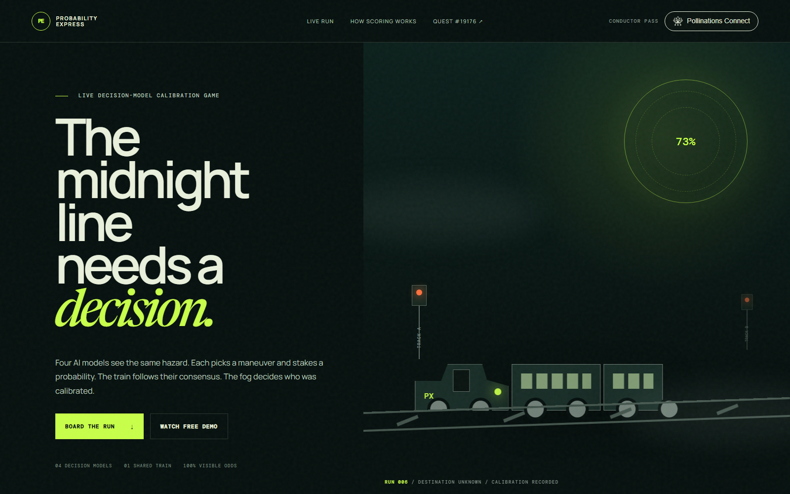

# Probability Express

[](https://pollinations.ai/?ref=badge)

Probability Express is a live calibration game for [Pollinations Quest #19176](https://github.com/pollinations/pollinations/issues/19176). Three free Pollinations decision models steer a night train through uncertain hazards. Each model chooses a maneuver, supplies probabilities, and earns a transparent calibration score after the result is revealed.



## How it works

- Three free decision models answer the same typed choice through `POST /alpha/decisions`.
- Their probability distributions are averaged into the crew's consensus maneuver.
- A visible d100 roll resolves the maneuver against the scenario's published success threshold.
- Models score well for calibrated confidence and lose ground for overconfident misses.
- Visitors connect their own Pollinations wallet through `<polli-connect>` with a capped temporary key.
- A zero-Pollen demo round is available before sign-in.

The live key is kept by the Pollinations connect component in session storage. It is never persisted by the app, and only a trusted user click can start a paid round.

## Local verification

```bash
npm test
npx serve dist
```

## License

MIT
